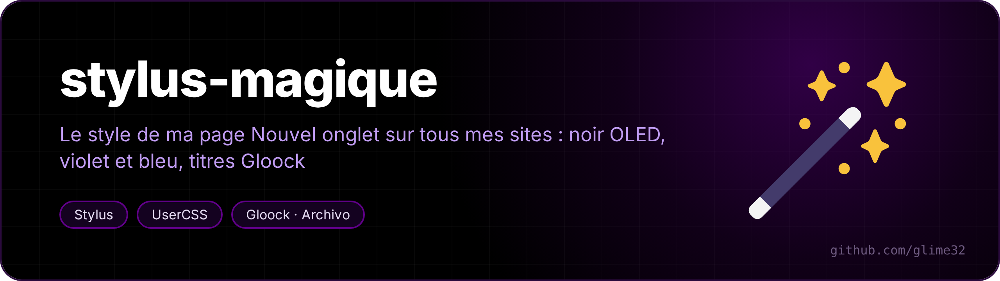
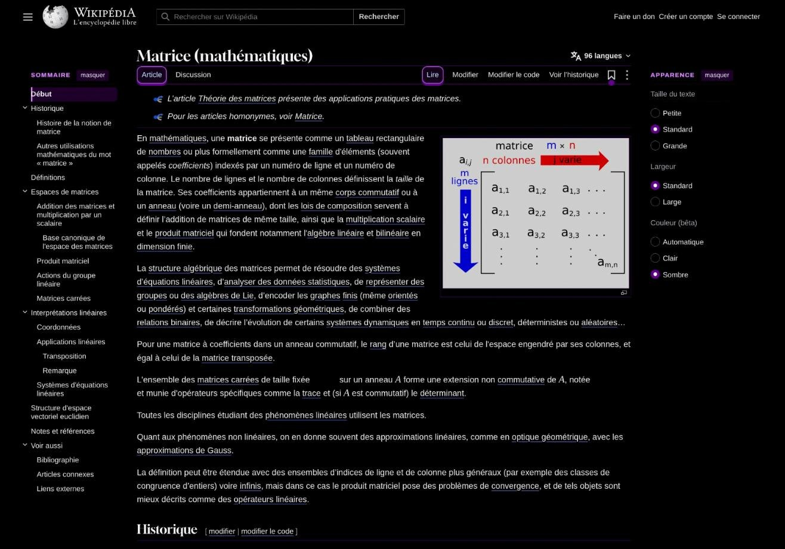
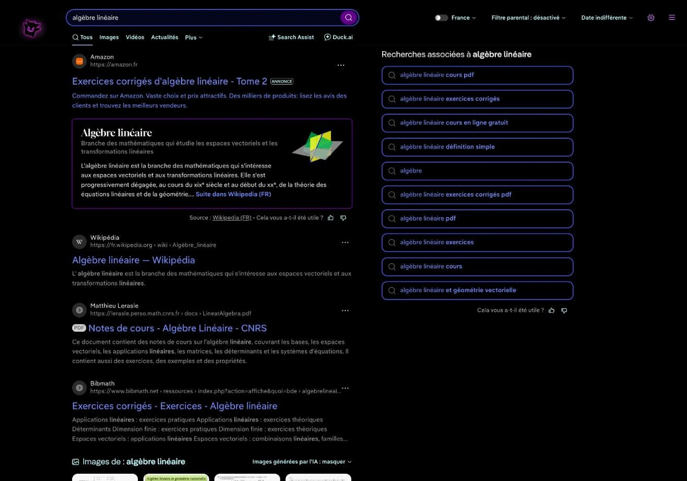
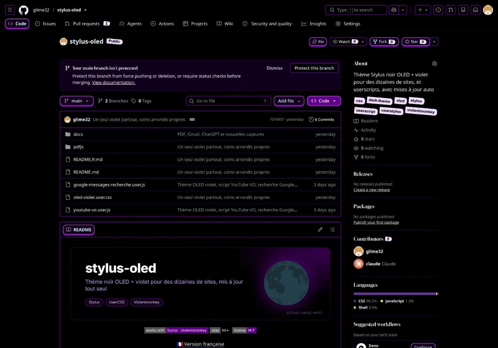
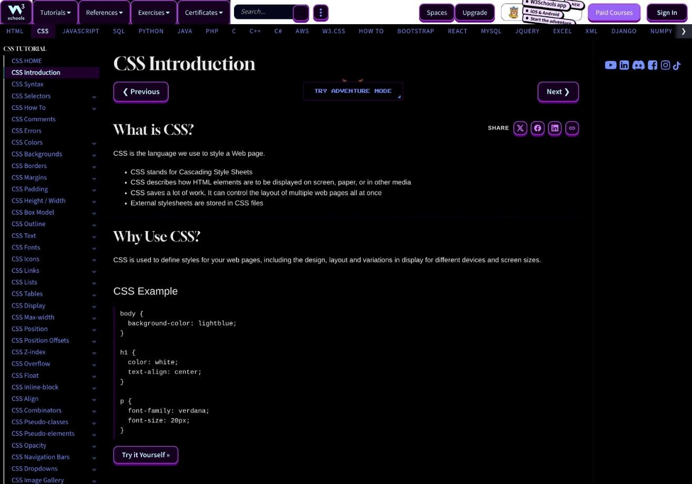

<p align="center"></p>

<p align="center">  </p>

<p align="center"><a href="README.md">🇬🇧 English version</a></p>

Le style de ma page [Nouvel onglet](https://github.com/glime32/nouvel-onglet-cours) appliqué à tous les sites que j'utilise : noir OLED, violet pour les boutons, bleu pour les liens et les champs, gros titres en Gloock, petits titres en Archivo élargie. Il reprend tous les sites et les réglages de [stylus-oled](https://github.com/glime32/stylus-oled), qu'il remplace.

<table>
<tr><td></td><td></td></tr>
<tr><td align="center"><sub>Wikipédia</sub></td><td align="center"><sub>DuckDuckGo</sub></td></tr>
<tr><td></td><td></td></tr>
<tr><td align="center"><sub>GitHub</sub></td><td align="center"><sub>W3Schools (site sans mode sombre)</sub></td></tr>
</table>

## Installer

1. Les polices. Beaucoup de sites bloquent les polices chargées par un style, alors elles s'installent sur le PC :

   ```bash
   mkdir -p ~/.local/share/fonts/stylus-magique && cd ~/.local/share/fonts/stylus-magique
   curl -fsSLO https://github.com/google/fonts/raw/main/ofl/gloock/Gloock-Regular.ttf
   curl -fsSL -o 'Archivo[wdth,wght].ttf' 'https://github.com/google/fonts/raw/main/ofl/archivo/Archivo%5Bwdth,wght%5D.ttf'
   fc-cache -f
   ```

   Puis redémarrer le navigateur.

2. Les styles, avec l'extension [Stylus](https://github.com/openstyles/stylus) :

   | Fichier | Rôle | |
   |---|---|---|
   | `stylus-magique.user.css` | le style des sites | [installer](https://raw.githubusercontent.com/glime32/stylus-magique/main/stylus-magique.user.css) |
   | `volet.user.css` | le volet violet entre deux pages d'un même site | [installer](https://raw.githubusercontent.com/glime32/stylus-magique/main/volet.user.css) |
   | `stylus-etude.user.css` | la version calme pour travailler (voir plus bas) | [installer](https://raw.githubusercontent.com/glime32/stylus-magique/main/stylus-etude.user.css) |
   | `claude-rapide.user.css` | claude.ai épuré dans une fenêtre appli (voir plus bas) | [installer](https://raw.githubusercontent.com/glime32/stylus-magique/main/claude-rapide.user.css) |

   Le volet est un style à part : on le coupe dans Stylus si on n'en veut plus. Les deux fichiers ont un `@updateURL` qui pointe ici. Le numéro `@version` monte à chaque modification, sinon Stylus garde l'ancienne : ce qui change est dans les [notes de version](CHANGELOG.md).

3. Le lecteur PDF (facultatif). Stylus ne peut pas styler une extension, alors `pdfjs/magique-pdfjs.css` s'ajoute dans une copie non empaquetée de l'extension « PDF Viewer » (PDF.js) : pages sombres à bord rouge sur fond violet, comme dans Xournal, barre du haut en deux languettes cachées, une à gauche et une à droite, qui descendent quand la souris arrive dans les 40 px du haut de leur côté (le milieu reste libre pour la barre du navigateur), icônes violet clair, numéro de page et zoom en pastilles, page en cours violet foncé avec la barre, mots trouvés en violet.

   ```bash
   curl -fsSL https://raw.githubusercontent.com/glime32/stylus-magique/main/pdfjs/install.sh | bash
   ```

   Le script trouve le lecteur, ajoute le CSS juste après `viewer.css` et installe un timer systemd qui le met à jour toutes les heures. Il remplace le thème PDF de stylus-oled s'il est là.

## Le style

- fond `#000` partout, texte `#EBEBEB`, titres aqua `#C5F9FC` ;
- titres de niveau 1 et 2 en **Gloock**, le reste garde la police du site ; petits titres, noms des champs et en-têtes de tableaux en **Archivo élargie**, en majuscules ;
- **violet** (`#610089`, `#D980FF`) pour les boutons et les cartes : bord de 2 px, ombre dure dessous, ils montent et penchent au survol ;
- **bleu** (`#7692FF`, `#1B2CC1`) pour les liens et les champs ; un lien survolé prend un fond bleu nuit, un lien déjà ouvert devient violet clair ;
- compteurs et badges en **étiquettes de bijoutier** (penchées, avec le trou) ; messages non lus en relief ; rubrique en cours en violet foncé avec une barre à gauche ; onglets plats, l'actif en relief ;
- rouge seulement pour le danger et les erreurs, le curseur de texte, le contour au clavier et le champ où l'on tape ;
- les pieds de page, liens Aide / Confidentialité et bannières « Essayer Premium » restent cachés.

Toutes les couleurs sont des variables `--sm-*` déclarées une seule fois en haut du fichier.

## Sites

Le fichier contient un bloc `@-moz-document` par site, et un bloc commun pour les sites qui n'ont pas de mode sombre. Une partie des sites :

- **Google** : Gmail, YouTube, Gemini, Keep, Messages, comptes Google, Recherche
- **Fac (Université de Montpellier)** : Moodle, CAS, ENT, emploi du temps ADE, bibliothèques
- **Messageries** : Discord, WhatsApp Web, Instagram, Snapchat, Telegram
- **Savoir et code** : Wikipédia et les wikis Wikimedia, DuckDuckGo, GitHub, GitLab, Stack Exchange, MDN, docs Python, ArchWiki, W3Schools, LeetCode, Codeforces, France-IOI, Kaggle…
- **Divers** : claude.ai, ChatGPT, SoundCloud, Spotify, Twitch, chess.com, Lichess, anime-sama, MangaDex, Steam, Amazon, Vinted, Doctolib, SNCF Connect…

Fait et testé sur [Helium](https://github.com/imputnet/helium) (Chromium) sous CachyOS / KDE Plasma.

## Stylus étude

Un second thème, pour les longues séances de travail : on coupe Stylus magique et on allume Stylus étude (jamais les deux à la fois). Mêmes sites, mais :

- texte gris clair `#C8C8C8`, titres `#EDEDED`, traits gris, liens lavande `#B7A6F2` ; le violet ne reste que sur le bouton principal ;
- rien ne bouge : pas d'ombre dure, pas de bascule, au survol seul le bord s'éclaircit ;
- pas d'étoiles, pas d'étiquettes de bijoutier, les polices des sites ;
- rouge seulement pour le curseur de texte, les erreurs et le danger ; le contour au clavier et le champ où l'on tape sont lavande ;
- images assombries à 70 %, normales au survol ; miniatures YouTube en gris ; formules et graphiques au gris du texte ; compteurs en petites pastilles grises ;
- les animations qui tournent en boucle s'arrêtent, sauf les ronds de chargement ;
- YouTube sans les vidéos proposées ni les Shorts (la playlist et le chat restent) ;
- texte 10 % plus grand et lignes plus aérées sur Wikipédia, ArchWiki, la doc Python et Moodle ; lignes aérées sur Stack Exchange.

Il n'est pas écrit à la main : `tools/etude.py` le fabrique à partir de `stylus-magique.user.css` et d'`etude/etude.css` (couleurs et ajouts), donc chaque correction de site faite dans Magique passe aussi dans Étude. `tools/apercu.py` capture une page avec les deux thèmes côte à côte.

```bash
python3 tools/etude.py
```

## Claude rapide

Pour poser une question vite : claude.ai ouvert dans une fenêtre « appli », sans onglets ni barre d'adresse (`helium-browser --app=https://claude.ai/new`, ça marche aussi avec Chrome ou Chromium). Le style ne laisse que la zone de texte, centrée, et le choix du modèle : plus de barre latérale, de barre du haut, de salutation, d'artéfacts récents, de « Projet », de micro ni de mode vocal, ni la phrase sur les erreurs, et la zone de texte reste vide (pas de phrase grise).

Il ne touche que ces fenêtres : elles répondent `display-mode: standalone`, un onglet répond `browser`, donc claude.ai dans les onglets ne change pas. Les couleurs restent celles du thème allumé (Magique ou Étude), sans étoile devant les titres et sans rien qui penche.

## Voir aussi

- [nouvel-onglet-cours](https://github.com/glime32/nouvel-onglet-cours) : la page Nouvel onglet qui a donné le style
- [helium-theme-oled-violet](https://github.com/glime32/helium-theme-oled-violet) : le thème du navigateur (barre du haut, onglets, pages internes)
- [stylus-oled](https://github.com/glime32/stylus-oled) : l'ancien style, et les userscripts YouTube VO et recherche Google Messages
