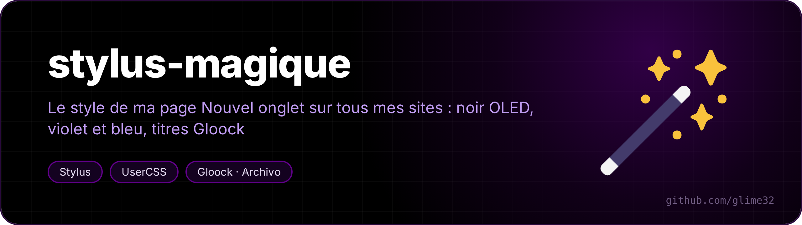
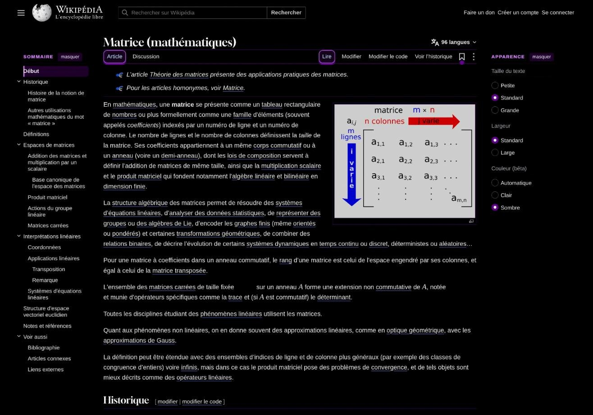
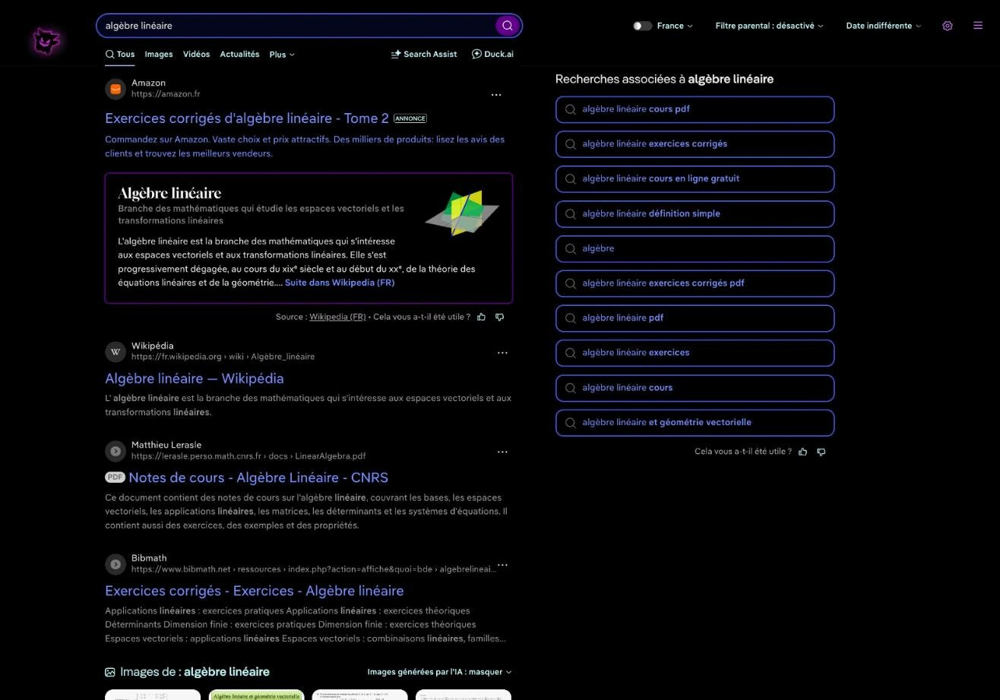
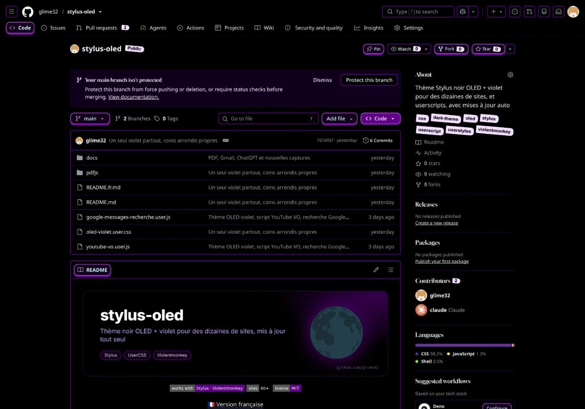
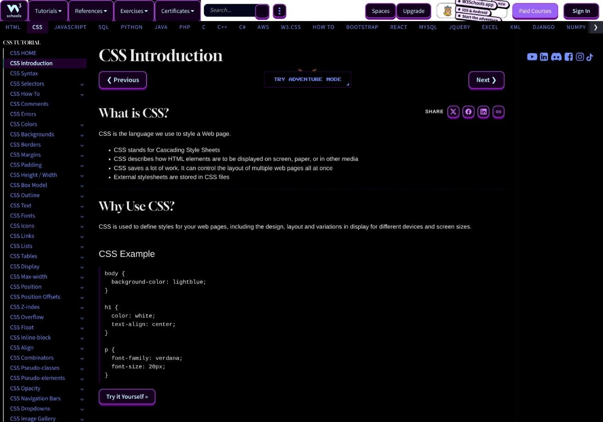

<p align="center"></p>

<p align="center">  </p>

<p align="center"><a href="README.fr.md">🇫🇷 Version française</a></p>

The look of my [new-tab page](https://github.com/glime32/nouvel-onglet-cours) on every site I use: OLED black, violet buttons, blue links and fields, big headings in Gloock, small headings in wide Archivo. It covers every site and fix of [stylus-oled](https://github.com/glime32/stylus-oled), which it replaces.

<table>
<tr><td></td><td></td></tr>
<tr><td align="center"><sub>Wikipedia</sub></td><td align="center"><sub>DuckDuckGo</sub></td></tr>
<tr><td></td><td></td></tr>
<tr><td align="center"><sub>GitHub</sub></td><td align="center"><sub>W3Schools (a site without dark mode)</sub></td></tr>
</table>

## Install

1. The fonts. Many sites block fonts loaded by a userstyle, so they are installed on the system:

   ```bash
   mkdir -p ~/.local/share/fonts/stylus-magique && cd ~/.local/share/fonts/stylus-magique
   curl -fsSLO https://github.com/google/fonts/raw/main/ofl/gloock/Gloock-Regular.ttf
   curl -fsSL -o 'Archivo[wdth,wght].ttf' 'https://github.com/google/fonts/raw/main/ofl/archivo/Archivo%5Bwdth,wght%5D.ttf'
   fc-cache -f
   ```

   Then restart the browser.

2. The styles, with the [Stylus](https://github.com/openstyles/stylus) extension:

   | File | What it does | |
   |---|---|---|
   | `stylus-magique.user.css` | the site styles | [install](https://raw.githubusercontent.com/glime32/stylus-magique/main/stylus-magique.user.css) |
   | `volet.user.css` | the violet wipe between two pages of the same site | [install](https://raw.githubusercontent.com/glime32/stylus-magique/main/volet.user.css) |
   | `stylus-etude.user.css` | the calm version for work (see below) | [install](https://raw.githubusercontent.com/glime32/stylus-magique/main/stylus-etude.user.css) |
   | `claude-rapide.user.css` | bare claude.ai in an app window (see below) | [install](https://raw.githubusercontent.com/glime32/stylus-magique/main/claude-rapide.user.css) |

   The wipe is a separate style, so it can be switched off on its own. Both files have an `@updateURL` pointing here. The `@version` number goes up with every change, otherwise Stylus keeps the old one: see the [release notes](CHANGELOG.md) (in French).

3. The PDF viewer (optional). Stylus can't style an extension, so `pdfjs/magique-pdfjs.css` goes into an unpacked copy of the "PDF Viewer" extension (PDF.js): dark pages with a red border on a violet background, like Xournal, the toolbar split into two hidden tabs, left and right, that slide down when the mouse reaches the top 40 px on their side (the middle stays free for the browser's own bar), light violet icons, page number and zoom as pills, current page in dark violet with the bar, matches in violet.

   ```bash
   curl -fsSL https://raw.githubusercontent.com/glime32/stylus-magique/main/pdfjs/install.sh | bash
   ```

   The script finds the viewer, adds the CSS right after `viewer.css` and installs a systemd timer that updates it every hour. It replaces the stylus-oled PDF theme if it is there.

## The look

- `#000` background everywhere, `#EBEBEB` text, aqua `#C5F9FC` headings;
- level 1 and 2 headings in **Gloock**, body text keeps the site's font; small headings, field labels and table headers in uppercase **wide Archivo**;
- **violet** (`#610089`, `#D980FF`) for buttons and cards: 2 px border, hard shadow below, they lift and tilt on hover;
- **blue** (`#7692FF`, `#1B2CC1`) for links and fields; a hovered link gets a navy background, a visited link turns light violet;
- counters and badges as **jeweler's tags** (tilted, with the hole); unread messages raised; current menu entry in dark violet with a bar on the left; flat tabs, the active one raised;
- red only for danger and errors, the text caret, the keyboard focus ring and the field being typed in;
- footers, Help / Privacy links and "Try Premium" banners stay hidden.

Every colour is a `--sm-*` variable declared once at the top of the file.

## Sites

The file has one `@-moz-document` block per site, plus a shared block for sites without a dark mode. Some of them:

- **Google**: Gmail, YouTube, Gemini, Keep, Messages, Google accounts, Search
- **University of Montpellier**: Moodle, CAS, ENT, ADE timetable, libraries
- **Messaging**: Discord, WhatsApp Web, Instagram, Snapchat, Telegram
- **Knowledge and code**: Wikipedia and the Wikimedia wikis, DuckDuckGo, GitHub, GitLab, Stack Exchange, MDN, Python docs, ArchWiki, W3Schools, LeetCode, Codeforces, France-IOI, Kaggle…
- **Misc**: claude.ai, ChatGPT, SoundCloud, Spotify, Twitch, chess.com, Lichess, anime-sama, MangaDex, Steam, Amazon, Vinted, Doctolib, SNCF Connect…

Made and tested on [Helium](https://github.com/imputnet/helium) (Chromium) on CachyOS / KDE Plasma.

## Stylus étude

A second theme for long work sessions: switch Stylus magique off and Stylus étude on (never both). Same sites, but:

- light grey text `#C8C8C8`, headings `#EDEDED`, grey lines, lavender links `#B7A6F2`; violet only stays on the main button;
- nothing moves: no hard shadow, no tilt, on hover only the border gets lighter;
- no stars, no jeweller tags, the sites' own fonts;
- red only for the text caret, errors and danger; the keyboard outline and the field being typed in are lavender;
- images dimmed to 70 %, normal on hover; YouTube thumbnails in grey; formulas and graphs in the text grey; counters in small grey pills;
- looping animations stop, except loading spinners;
- YouTube without suggested videos or Shorts (the playlist and the chat stay);
- 10 % bigger text and more line spacing on Wikipedia, ArchWiki, the Python docs and Moodle; more line spacing on Stack Exchange.

It is not written by hand: `tools/etude.py` builds it from `stylus-magique.user.css` and `etude/etude.css` (colours and additions), so every site fix made in Magique also reaches Étude. `tools/apercu.py` captures a page with both themes side by side.

```bash
python3 tools/etude.py
```

## Claude rapide

For a quick question: claude.ai in an "app" window, with no tabs and no address bar (`helium-browser --app=https://claude.ai/new`, Chrome or Chromium work too). The style keeps only the text box, centred, and the model picker: no sidebar, top bar, greeting, recent artifacts, "Project", microphone, voice mode or mistakes notice.

It only touches those windows: they answer `display-mode: standalone` while a tab answers `browser`, so claude.ai in tabs does not change. Colours stay those of the theme that is on (Magique or Étude), without the star before headings and with nothing tilting.

## See also

- [nouvel-onglet-cours](https://github.com/glime32/nouvel-onglet-cours): the new-tab page this look comes from
- [helium-theme-oled-violet](https://github.com/glime32/helium-theme-oled-violet): the browser theme (toolbar, tabs, internal pages)
- [stylus-oled](https://github.com/glime32/stylus-oled): the previous style, plus the YouTube original-audio and Google Messages search userscripts
